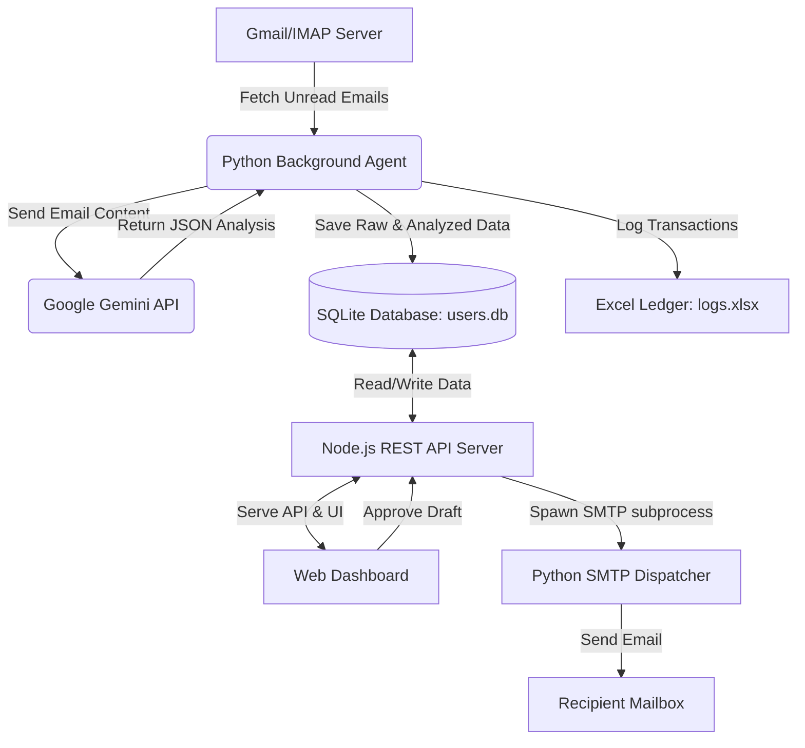

# AI-Powered Email Automation & Assistant System
### Complete Project Documentation (Start to End)

This document provides a comprehensive overview of the **AI-Powered Email Automation System**, detailing its system architecture, technology stack, database schema, key features, directory structure, and setup guide. You can share this document directly with your friend or team.

---

## 1. Project Overview

The **AI-Powered Email Automation System** is an end-to-end self-hosted email management platform. It automates the process of fetching unread emails from a live IMAP mailbox (like Gmail), uses Google's Gemini LLMs to analyze them (summarizing, prioritizing, categorizing, extracting tasks, and drafting replies), and lets the user review and approve drafts directly from an elegant split-panel web dashboard. Approved replies are dispatched using a secure SMTP pipeline.

### High-Level System Workflow


---

## 2. Key Features

1. **Sleek Split-Pane Dashboard**: A modern frontend offering an immediate overview of metrics (Total Processed, Urgent Alerts, Replies Drafted, Sent) alongside a workspace to read emails, modify AI-generated drafts, and view extracted action items.
2. **Background AI Email Agent**: A Python worker that connects to your IMAP server, checks for unread emails, and parses them.
3. **Google Gemini LLM Integration**: Generates deep insights for every email:
   * **Priority**: High (Urgent), Medium, or Low.
   * **Category**: Classified as `important`, `spam`, `newsletter`, or `promotion`.
   * **Intent**: A short summary of the sender's goal.
   * **Summary**: A brief 2-3 sentence overview.
   * **Action Items**: A list of key tasks extracted from the email.
   * **Draft Reply**: A context-aware draft matching the tone of the sender.
4. **Task Kanban/To-Do List**: Action items extracted by Gemini are automatically inserted as actionable tasks inside a to-do list manager where status and deadlines can be edited.
5. **Secure Authentication & Account Security**:
   * Secure signup and login with PBKDF2 password hashing + unique cryptographic salts.
   * Forgot Password system generating a 6-digit OTP code sent directly via SMTP.
6. **Smart Auto-Send Timer & Editor**: Draft replies are queued to send automatically in 20 minutes. If the user edits the draft, the timer resets to 20 minutes. Users can also manually approve (send immediately) or reject (delete draft).
7. **Double Logging Audits**: Saves details of every incoming email both in the SQL database and logs them to a spreadsheet (`data/exports/logs.xlsx`) using `openpyxl`.
8. **Rate-Limit Resilience (429 Backoff)**: If Gemini hits a rate limit, the Python agent reads the required sleep time from the API response and waits dynamically before retrying.

---

## 3. Technology Stack

### Frontend (User Interface)
* **Core**: Semantic HTML5, Vanilla JavaScript (ES6+).
* **Styling**: Vanilla CSS3 utilizing CSS variables, responsive Grid/Flexbox layouts, glassmorphism UI structures, clean scrollbars, and micro-animations.
* **Libraries**: Chart.js (for rendering metrics and email distribution graphs dynamically).

### Backend (REST API Server)
* **Server Runtime**: Node.js (Standard HTTP module, no external framework dependencies like Express, keeping it lightweight and fast).
* **Database Driver**: Built-in `node:sqlite` (DatabaseSync module) for raw SQL query executions.

### AI & Operations Worker
* **Core Language**: Python 3.
* **Libraries Used**:
  * `imapclient`: Secure SSL connection to IMAP email servers.
  * `openpyxl`: Excel ledger generator.
  * `urllib`: Standard library used to call Gemini API endpoints.
  * `sqlite3`: Native SQLite connector.

### Database (Relational Storage)
* **Database**: SQLite3. Stores configurations, user credentials, email archives, and task records in a zero-configuration local file (`users.db`).

---

## 4. Database Schema

The SQLite database (`users.db`) contains four core tables:

### A. `users` Table
Stores login accounts, credentials, and IMAP sync configs.
| Column | Type | Constraints | Description |
| :--- | :--- | :--- | :--- |
| `id` | INTEGER | PRIMARY KEY AUTOINCREMENT | Unique user identifier |
| `email` | TEXT | UNIQUE, NOT NULL | Login email address |
| `password_hash` | TEXT | NOT NULL | PBKDF2 password hash |
| `salt` | TEXT | NOT NULL | Unique cryptographic salt |
| `role` | TEXT | DEFAULT 'user' | Access level (`admin` or `user`) |
| `imap_server` | TEXT | - | User-configured IMAP host |
| `imap_user` | TEXT | - | User-configured IMAP email username |
| `imap_password` | TEXT | - | Password/App Password for IMAP/SMTP |
| `reset_token` | TEXT | - | OTP token for password recovery |
| `created_at` | TEXT | NOT NULL | ISO Timestamp |

### B. `emails` Table
Stores ingested emails along with Gemini AI insights.
| Column | Type | Constraints | Description |
| :--- | :--- | :--- | :--- |
| `id` | INTEGER | PRIMARY KEY AUTOINCREMENT | Unique email record identifier |
| `user_id` | INTEGER | FOREIGN KEY (users.id) | Belongs to which user account |
| `sender` | TEXT | NOT NULL | Sender's email address |
| `subject` | TEXT | - | Email subject header |
| `body` | TEXT | - | Email body content |
| `received_at` | TEXT | NOT NULL | ISO Timestamp of ingestion |
| `priority` | TEXT | DEFAULT 'Medium' | High, Medium, or Low |
| `status` | TEXT | DEFAULT 'Pending' | `Pending`, `Sent`, `Auto-Sent`, `Rejected` |
| `category` | TEXT | DEFAULT 'important' | `important`, `spam`, `newsletter`, `promotion` |
| `intent` | TEXT | - | Extracted sender intention |
| `summary` | TEXT | - | 2-3 sentence AI summary |
| `action_items` | TEXT | - | JSON array of action items |
| `draft_reply` | TEXT | - | AI drafted response |
| `send_at` | TEXT | - | ISO Timestamp for the Auto-Send queue |
| `edited_at` | TEXT | - | ISO Timestamp of last manual edit |

### C. `tasks` Table
Stores tasks that are either added manually or extracted from action items.
| Column | Type | Constraints | Description |
| :--- | :--- | :--- | :--- |
| `id` | INTEGER | PRIMARY KEY AUTOINCREMENT | Unique task identifier |
| `user_id` | INTEGER | FOREIGN KEY (users.id) | Owner of the task |
| `email_id` | INTEGER | FOREIGN KEY (emails.id) | Linked email (if auto-extracted) |
| `title` | TEXT | NOT NULL | Task name |
| `description` | TEXT | - | Task description |
| `status` | TEXT | DEFAULT 'To Do' | `To Do`, `In Progress`, `Done` |
| `priority` | TEXT | DEFAULT 'Medium' | High, Medium, or Low |
| `due_date` | TEXT | - | Optional deadline date |
| `created_at` | TEXT | NOT NULL | ISO Timestamp of creation |

### D. `settings` Table
Key-Value storage for global variables (e.g., global API keys, default models).
| Column | Type | Constraints | Description |
| :--- | :--- | :--- | :--- |
| `key` | TEXT | PRIMARY KEY | Configuration key name |
| `value` | TEXT | - | Configuration value |

---

## 5. Directory Structure & File Roles

```
email/
├── backend/
│   ├── db.js             # Database setup, tables initialization, and SQL statements
│   ├── server.js         # Node.js API server. Handles routing and server-side timer
│   ├── agent.py          # Background Python script checking mail and calling Gemini
│   └── send_email.py     # Python CLI utility to dispatch emails over SMTP SSL
│
├── frontend/
│   ├── index.html        # Authentication portal (Login, Signup, Reset Password)
│   ├── dashboard.html    # Core dashboard interface
│   ├── css/
│   │   └── style.css     # CSS rules for auth pages and dashboard
│   └── js/
│       ├── auth.js       # Manages login sessions, signup, and reset forms
│       ├── app.js        # Main dashboard logic (fetching emails, editing drafts, and tasks)
│       └── charts.js     # Logic to load charts and graphs on dashboard
│
├── data/
│   └── exports/
│       └── logs.xlsx     # Excel file where transactions are appended
│
├── .env                  # Environmental configuration (API keys, ports)
├── users.db              # SQLite Database file (created on startup)
├── requirements.txt      # Python dependencies list
├── run.ps1               # PowerShell startup script (Windows)
├── run.bat               # Batch startup file (Windows Cmd)
└── run.sh                # Shell runner (Linux/macOS)
```

---

## 6. Setup & Execution Guide

### Step 1: Install Dependencies
Open your command terminal in the project directory and install python packages:
```bash
pip install -r requirements.txt
```
*Dependencies installed: `imapclient` and `openpyxl`.*

### Step 2: Configure Environment
Create a `.env` file in the root folder (or edit the existing one):
```env
GEMINI_API_KEY=your_gemini_api_key_here
IMAP_SERVER=imap.gmail.com
IMAP_PORT=993
IMAP_USER=your-email@gmail.com
IMAP_PASSWORD=your-gmail-app-password
```
> **Note**: For Gmail, you must generate an **App Password** inside your Google Account Security settings instead of using your main password.

### Step 3: Run the Application
Start the Node.js server and Python agent simultaneously:
* **Windows (PowerShell)**:
  ```powershell
  .\run.ps1
  ```
* **Windows (Command Prompt)**:
  ```cmd
  run.bat
  ```
* **Linux/macOS**:
  ```bash
  chmod +x run.sh
  ./run.sh
  ```

Once started, open **`http://localhost:3000`** in your web browser. Default admin login is your `IMAP_USER` email address, and the default password is `admin123` (you can configure custom users or settings directly via the Settings tab in the dashboard).
